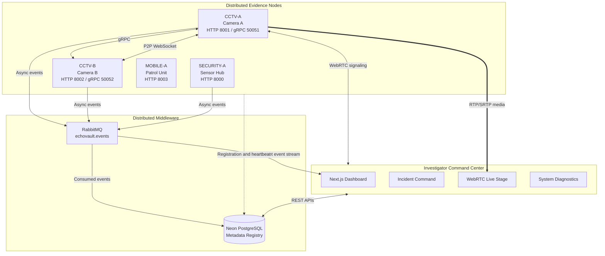

# EchoVault

## Complete Distributed Systems Project Documentation

**Project type:** Distributed Systems FA-1 Project  
**Project title:** Distributed Digital Evidence Collection, Incident Reconstruction, and Real-Time Multimedia Streaming System  
**Academic year:** 2026-27  
**Department:** Computer Engineering  
**Institution:** Pimpri Chinchwad College of Engineering, Nigdi, Pune  
**Technology:** FastAPI, Python, Next.js, React, TypeScript, PostgreSQL, RabbitMQ, gRPC, WebSockets, WebRTC, Docker

---

## 1. Project Overview

EchoVault is a distributed digital evidence platform that models how independent cameras, sensor gateways, and mobile patrol devices can cooperate during an investigation.

The system is designed around four main principles:

1. **Distributed ownership:** Raw evidence remains owned and stored by the node that captured it.
2. **Protocol specialization:** Different distributed communication mechanisms are used for different workloads.
3. **Incident correlation:** Evidence from many nodes can be associated with one shared logical incident.
4. **Fault isolation:** Failure of one node or middleware component should not unnecessarily stop unrelated parts of the system.

The project demonstrates the following communication mechanisms:

- REST APIs for browser-to-backend operations.
- gRPC for synchronous node-to-node remote procedure calls.
- RabbitMQ for asynchronous publish/subscribe event delivery.
- WebSockets for real-time dashboard event streams.
- Direct P2P WebSockets for node-to-node communication.
- WebRTC for low-latency audio and video streaming.

EchoVault is intended as an educational distributed-systems implementation. It uses deterministic demo media and seeded data so the complete demonstration can be reproduced on one machine using Docker Compose.

---

## 2. Problem Statement

Digital evidence is often generated by multiple independent sources:

- CCTV cameras record visual evidence.
- Security sensors detect physical events.
- Mobile units collect body-camera and acoustic data.
- Different facilities may own and control their own evidence.

A centralized application creates several problems:

- A central service can become a single point of failure.
- Large multimedia files create bandwidth and storage bottlenecks.
- Nodes may belong to different physical locations or administrative domains.
- A failure in one source should not make all other sources unavailable.
- Investigators need a unified view without copying every raw file into one central store.
- Some operations need an immediate response, while others are naturally asynchronous.

EchoVault addresses these requirements by creating independent evidence nodes that communicate through explicitly defined distributed protocols. The investigator sees one command center, but the underlying evidence and execution state remain distributed.

---

## 3. Project Objectives

### 3.1 Primary objectives

- Build autonomous evidence-producing node services.
- Maintain local evidence ownership at the originating node.
- Provide a shared incident model for multi-node investigations.
- Implement multiple communication mechanisms in one working system.
- Support synchronous remote evidence access through gRPC.
- Support asynchronous event delivery through RabbitMQ.
- Provide continuous event updates using WebSockets.
- Provide direct peer-to-peer node messaging.
- Stream live demo audio/video using WebRTC.
- Demonstrate node health, failure simulation, recovery, and isolation.
- Package the complete system using Docker Compose.

### 3.2 Educational objectives

The project connects implementation with distributed-systems topics:

- Autonomous distributed processes.
- Message passing over a network.
- Remote procedure calls.
- Message-oriented middleware.
- Stream-oriented communication.
- Peer-to-peer communication.
- Distributed multimedia systems.
- Fault isolation and liveness.
- Logical clocks, election, mutual exclusion, snapshots, and replication demonstrations.
- Containerization and reproducible multi-service deployment.

---

## 4. High-Level Architecture



### 4.1 Architectural layers

| Layer | Main responsibility |
|---|---|
| Investigator UI | Displays topology, evidence, incidents, messages, health and live media |
| REST API | Provides CRUD operations and browser-facing control endpoints |
| Coordinator service | Maintains node registry, metadata, incidents and orchestration |
| Evidence nodes | Own local evidence, expose node APIs and participate in distributed communication |
| gRPC layer | Performs typed synchronous remote calls |
| RabbitMQ layer | Publishes and consumes asynchronous events |
| WebSocket layer | Pushes live events to browsers |
| P2P layer | Provides direct node-to-node communication |
| WebRTC layer | Negotiates and transports live audio/video |
| PostgreSQL | Stores metadata, registry records, relationships and operational state |
| Local storage | Stores evidence payloads on the owning node |

---

## 5. Distributed Node Model

EchoVault uses the same backend service image with different environment configuration for different logical nodes.

| Node ID | Name | Type | Video | Audio | HTTP port | gRPC port | Description |
|---|---|---|:---:|:---:|---:|---:|---|
| `CCTV-A` | CCTV Camera A | `evidence` | Yes | Yes | 8001 | 50051 | Fixed perimeter optical camera overlooking Sector 4 |
| `CCTV-B` | CCTV Camera B | `evidence` | Yes | Yes | 8002 | 50052 | Dome camera monitoring an emergency exit corridor |
| `SECURITY-A` | Security Sensor Hub | `security` | Yes | No | 8000 | 50051 | IoT gateway aggregating IR tripwire events |
| `MOBILE-A` | Mobile Patrol Unit A | `mobile` | Yes | Yes | 8003 | 50053 | Wearable body-camera and acoustic scanner |

The Docker Compose deployment currently starts the coordinator backend and two independently configured evidence nodes. The other logical node roles are represented by the registry and demo scenario and can be run as additional instances of the same service.

### 5.1 Logical identity versus network address

EchoVault separates:

- Logical node identity: `node_id`, `node_name`, and `node_type`.
- HTTP address: `host` and `port`.
- gRPC address: `grpc_host` and `grpc_port`.
- P2P address: `p2p_host` and `p2p_port`.
- Capabilities: `supports_video`, `supports_audio`, and media mode.

This separation allows a node to keep the same logical identity even when its deployment address changes.

---

## 6. Evidence Ownership and Incident Model

### 6.1 Local evidence ownership

Every evidence record has one authoritative owner:

- `EV-001` can be owned by `CCTV-A`.
- `EV-002` can be owned by `CCTV-B`.
- `EV-003` can be owned by `SECURITY-A`.
- `EV-004` can be owned by `MOBILE-A`.

The owning node stores the raw evidence payload in its own evidence storage directory. Other nodes do not directly read that directory.

### 6.2 Shared logical incidents

An incident is a distributed correlation context. It can include:

- Incident identifier.
- Title and description.
- Severity.
- Status.
- Creation and update timestamps.
- Participating nodes.
- Evidence associations.

The demo incident is:

```text
Incident ID: INC-000001
Title: Restricted Area Intrusion
Severity: HIGH
Status: OPEN
```

The incident links observations from different evidence owners without merging all files into a single central file store.

### 6.3 Remote evidence retrieval

When the investigator requests evidence owned by another node:

1. The browser calls the coordinator REST endpoint.
2. The coordinator identifies the evidence owner.
3. The coordinator creates a gRPC request to the owner node.
4. The owner returns typed metadata through the gRPC service.
5. The coordinator returns the response and measured latency to the browser.

The requesting node never accesses the remote node's storage directly.

---

## 7. Communication Mechanisms

| Mechanism | Transport | Pattern | EchoVault use |
|---|---|---|---|
| REST | HTTP/1.1 and JSON | Request/response | CRUD, registration, evidence and incident management |
| gRPC | HTTP/2 and Protocol Buffers | Synchronous RPC | Remote evidence and node status calls |
| RabbitMQ | AMQP 0-9-1 | Asynchronous publish/subscribe | Event fanout, durable delivery, retries and routing |
| WebSocket events | WebSocket | Continuous stream | Live event updates for the dashboard |
| P2P WebSocket | WebSocket | Direct point-to-point mesh | Telemetry, announcements, ping/pong and direct messages |
| WebRTC | ICE, RTP/SRTP over UDP | Real-time multimedia | Live video and audio from evidence nodes |

### 7.1 REST

REST is used for browser-facing operations where the client needs a direct response:

- Create and list evidence.
- Upload evidence.
- Create and update incident associations.
- Discover registered nodes.
- Read node health.
- Request remote gRPC operations.
- Start and inspect WebRTC sessions.
- Control demo, Unit 3 and Unit 4 features.

### 7.2 gRPC

gRPC is used for typed, synchronous node-to-node communication.

Characteristics:

- HTTP/2 transport.
- Protocol Buffers serialization.
- Generated client stubs and server handlers.
- Explicit RPC deadlines and timeouts.
- Structured gRPC status codes.
- Suitable for immediate remote status or evidence metadata requests.

Typical operations include:

- `GetEvidence`.
- `GetNodeStatus`.
- Remote incident evidence lookup.

### 7.3 RabbitMQ

RabbitMQ provides asynchronous communication through the `echovault.events` exchange.

Events include:

- `evidence.created`.
- `evidence.updated`.
- `evidence.deleted`.
- `node.status_changed`.
- `incident.created`.
- `incident.updated`.
- `webrtc.session_requested`.
- `webrtc.session_started`.
- `webrtc.session_ended`.
- `webrtc.session_failed`.
- `replication.completed`.

The messaging design supports:

- Topic routing.
- Durable messages.
- Consumer acknowledgements.
- Retry limits.
- Message TTL.
- Dead-letter handling.
- Idempotent message consumption.

### 7.4 WebSocket event stream

The `/ws/events` endpoint maintains a live connection between the dashboard and backend.

It supports:

- Continuous server-to-browser event delivery.
- Event filtering.
- Node filtering.
- Incident filtering.
- Keep-alive behavior.
- Live dashboard refresh without polling.

### 7.5 P2P WebSocket mesh

The `/ws/peer` endpoint is used for direct communication between nodes.

P2P capabilities include:

- Peer discovery.
- Connection and disconnection.
- Handshake and handshake acknowledgement.
- Target identity verification.
- Ping/pong round-trip measurement.
- Direct messages.
- Evidence announcements.
- Incident announcements.
- Duplicate message rejection.

Each message has a unique `message_id`. Receiving nodes maintain idempotency state so repeated delivery does not cause repeated processing.

### 7.6 WebRTC

WebRTC is used for live media, not ordinary application events.

Signaling is separated from media:

```text
Browser                         Evidence Node
   |                                 |
   |-- WebSocket /ws/webrtc/id ----->|
   |-- SDP offer ------------------->|
   |<-- SDP answer ------------------|
   |<-- ICE candidate exchange ----->|
   |                                 |
   |<====== RTP/SRTP audio/video ===>|
```

The demo media implementation provides:

- Synthetic video frames.
- Timestamp or surveillance HUD overlay.
- Approximately 25 FPS video.
- Synthetic audio tone.
- Browser-native playback.
- `aiortc`-based peer connections.

---

## 8. Backend Implementation

The backend is a Python FastAPI service located under `services/node`.

### 8.1 Main backend modules

```text
services/node/app/
├── config.py                 Environment and application settings
├── database.py               Async database engine and session handling
├── main.py                   FastAPI application entry point
├── grpc/
│   ├── handlers.py           gRPC service handlers
│   ├── server.py             gRPC server lifecycle
│   ├── time_utils.py         RPC timing helpers
│   └── generated/            Generated Protocol Buffer code
├── messaging/
│   ├── config.py             RabbitMQ settings
│   ├── connection.py         Broker connections
│   ├── consumer.py           Event consumers
│   ├── handlers.py           Event handlers
│   ├── publisher.py          Event publishing
│   └── schemas.py            Message schemas
├── middleware/
│   └── request_context.py    Request context and tracing
├── models/                   SQLAlchemy models
├── p2p/                      Peer-to-peer managers and protocol
├── routers/                  HTTP and WebSocket endpoints
├── schemas/                  Pydantic request/response models
├── services/                 Domain services and registries
├── unit3.py                  Synchronization demonstrations
├── unit4.py                  Replication demonstrations
├── webrtc/                   WebRTC manager and media tracks
└── websocket/                Event stream manager
```

### 8.2 Data models

The main models are:

- `Node`: Registered node identity, address, type, status and capabilities.
- `Evidence`: Local evidence metadata and file ownership.
- `Incident`: Shared investigation context.
- `PeerMessage`: Direct P2P message record.
- `ReceivedMessage`: Message idempotency and delivery tracking.
- `WebRTCSession`: Media session lifecycle and signaling metadata.

### 8.3 Database migrations

Alembic migrations define:

1. Node registry.
2. Evidence records.
3. Incidents.
4. gRPC address fields.
5. Received message tracking.
6. P2P support.
7. WebRTC support.
8. Node-scoped received-message identifiers.

### 8.4 Error handling

The system uses:

- HTTP status codes for REST failures.
- gRPC status codes for remote RPC failures.
- Health endpoints for dependency state.
- Timeouts for unavailable remote nodes.
- Retry limits for broker messages.
- Idempotency checks for duplicate events.
- Controlled node-offline responses instead of cascading crashes.

---

## 9. REST API Reference

The exact prefix is configured by the application router. The following table summarizes the implemented endpoint groups.

### 9.1 Health endpoints

| Method | Endpoint | Purpose |
|---|---|---|
| `GET` | `/` | Basic service response |
| `GET` | `/health` | Overall service health |
| `GET` | `/health/database` | Database connectivity |
| `GET` | `/health/messaging` | RabbitMQ health |
| `GET` | `/health/websocket` | WebSocket manager health |
| `GET` | `/health/p2p` | P2P manager health |
| `GET` | `/health/webrtc` | WebRTC subsystem health |

### 9.2 Identity and node registry

| Method | Endpoint | Purpose |
|---|---|---|
| `GET` | `/identity/self` | Read configured node identity |
| `POST` | `/identity/self/register` | Register the current service |
| `POST` | `/nodes` | Register a node |
| `GET` | `/nodes` | Discover registered nodes |
| `GET` | `/nodes/{node_id}` | Get one registered node |
| `POST` | `/nodes/{node_id}/heartbeat` | Record node liveness |
| `DELETE` | `/nodes/{node_id}` | Deactivate a node |

### 9.3 Evidence

| Method | Endpoint | Purpose |
|---|---|---|
| `POST` | `/evidence` | Create local evidence metadata |
| `GET` | `/evidence` | List evidence owned by the current node |
| `POST` | `/evidence/upload` | Upload local evidence |
| `GET` | `/evidence/{evidence_id}` | Retrieve local evidence metadata |
| `DELETE` | `/evidence/{evidence_id}` | Soft-delete local evidence |
| `GET` | `/evidence/{evidence_id}/file` | Download a local evidence file |

### 9.4 Incidents

| Method | Endpoint | Purpose |
|---|---|---|
| `POST` | `/incidents` | Create an incident |
| `GET` | `/incidents` | List incidents |
| `GET` | `/incidents/{incident_id}` | Read an incident |
| `POST` | `/incidents/{incident_id}/evidence/{evidence_id}` | Attach local evidence |
| `DELETE` | `/incidents/{incident_id}/evidence/{evidence_id}` | Remove evidence association |
| `GET` | `/incidents/{incident_id}/evidence` | List local incident evidence |
| `POST` | `/incidents/{incident_id}/nodes/{node_id}` | Add a participating node |
| `GET` | `/incidents/{incident_id}/nodes` | List participating nodes |
| `DELETE` | `/incidents/{incident_id}/nodes/{node_id}` | Deactivate a participating node |

### 9.5 Remote gRPC proxy operations

| Method | Endpoint | Purpose |
|---|---|---|
| `GET` | `/remote/nodes/{node_id}/status` | Query a node through gRPC |
| `GET` | `/remote/nodes/{node_id}/evidence/{evidence_id}` | Query remote evidence metadata |
| `GET` | `/remote/nodes/{node_id}/incidents/{incident_id}/evidence` | Query remote incident evidence |

### 9.6 Messaging and events

| Method | Endpoint | Purpose |
|---|---|---|
| `GET` | Messaging health/status endpoint | Read broker and consumer information |
| `POST` | Messaging publish/test endpoint | Inject or publish a distributed event |
| `WS` | `/ws/events` | Subscribe to real-time backend events |

### 9.7 P2P

| Method | Endpoint | Purpose |
|---|---|---|
| `WS` | `/ws/peer` | Direct peer connection |
| `GET` | `/api/v1/peers` | List peer status |
| `POST` | `/api/v1/peers/{node_id}/connect` | Connect to a peer |
| `POST` | `/api/v1/peers/{node_id}/disconnect` | Disconnect from a peer |
| `POST` | `/api/v1/peers/{node_id}/ping` | Measure peer round-trip latency |
| `POST` | `/api/v1/peers/{node_id}/message` | Send direct peer message |
| `POST` | `/api/v1/peers/{node_id}/announce/evidence/{evidence_id}` | Announce evidence |
| `POST` | `/api/v1/peers/{node_id}/announce/incident/{incident_id}` | Announce incident |
| `GET` | `/api/v1/peers/messages` | List received peer messages |

### 9.8 WebRTC

The WebRTC router provides endpoints to:

- Create a session.
- Submit or exchange offers and answers.
- Exchange ICE candidates.
- Inspect a session.
- List or inspect active sessions.
- Connect through `/ws/webrtc/{session_id}` signaling.

### 9.9 Unit 3 synchronization demonstrations

| Method | Endpoint | Purpose |
|---|---|---|
| `GET` | `/api/v1/unit3/state` | Read synchronization state |
| `POST` | `/api/v1/unit3/reset` | Reset Unit 3 state |
| `POST` | `/api/v1/unit3/clock/tick` | Advance a Lamport clock |
| `POST` | `/api/v1/unit3/beacon` | Record a node beacon |
| `POST` | `/api/v1/unit3/clock/synchronize` | Demonstrate Cristian-style synchronization |
| `POST` | `/api/v1/unit3/election` | Run deterministic Bully election |
| `POST` | `/api/v1/unit3/lock/request` | Request a shared incident lock |
| `POST` | `/api/v1/unit3/lock/release` | Release the shared incident lock |
| `POST` | `/api/v1/unit3/snapshot` | Capture a marker-style global state |

### 9.10 Unit 4 replication demonstrations

| Method | Endpoint | Purpose |
|---|---|---|
| `GET` | `/api/v1/unit4/state` | Read Unit 4 state |
| `POST` | `/api/v1/unit4/reset` | Reset Unit 4 state |
| `POST` | `/api/v1/unit4/replication/request` | Request evidence replication |
| `GET` | `/api/v1/unit4/replication/{evidence_id}` | Read replication metadata |

### 9.11 Demo endpoints

| Method | Endpoint | Purpose |
|---|---|---|
| `POST` | Demo seed endpoint | Seed the complete FA-1 scenario |
| `POST` | Node status simulation endpoint | Simulate node failure or recovery |
| `POST` | Event simulation endpoint | Inject a custom distributed event |
| `POST` | Demo reset endpoint | Reset the demonstration environment |

---

## 10. Frontend Command Center

The frontend is a Next.js and React application under `frontend`.

### 10.1 Main pages

| Route | Purpose |
|---|---|
| `/` | Application landing or initialization page |
| `/dashboard` | Unified operations dashboard and topology |
| `/incidents` | Incident listing |
| `/incidents/{incidentId}` | Incident command center |
| `/evidence` | Evidence browser |
| `/live` | WebRTC live multimedia stage |
| `/messaging` | RabbitMQ and event monitor |
| `/nodes` | Registered node view |
| `/peers` | Direct P2P mesh manager |
| `/system` | Health, diagnostics, simulation and Unit 3/4 controls |

### 10.2 Dashboard functions

The dashboard displays:

- Registered nodes.
- Online/offline state.
- Node type and capabilities.
- Incident severity and status.
- Local versus remote evidence ownership.
- Recent event activity.
- Messaging health.
- P2P connection state.
- WebRTC session state.
- Distributed topology.

### 10.3 Event stream hook

The `useEventStream` hook maintains the browser connection to `/ws/events`, receives events and updates the dashboard without manual refresh.

### 10.4 WebRTC session hook

The `useWebRTCSession` hook:

1. Creates or identifies a session.
2. Opens signaling.
3. Creates an `RTCPeerConnection`.
4. Exchanges SDP offer/answer information.
5. Exchanges ICE candidates.
6. Attaches remote tracks to the media player.
7. Handles cleanup and session termination.

---

## 11. Database and Storage

### 11.1 PostgreSQL metadata

The PostgreSQL-compatible database stores structured metadata:

- Node registry.
- Node addresses and capabilities.
- Evidence metadata.
- Incident records.
- Incident-to-evidence relationships.
- Incident-to-node relationships.
- Received message identifiers.
- P2P messages.
- WebRTC session information.

The database is not intended to hold every raw multimedia file.

### 11.2 Local evidence storage

Each node uses its configured `STORAGE_DIR`, for example:

```text
storage/evidence
```

In Docker, evidence storage is mounted into node-specific volumes:

- `evidence_storage`
- `evidence_node_a`
- `evidence_node_b`

### 11.3 Data consistency approach

EchoVault maintains consistency using:

- Database constraints.
- Typed Pydantic schemas.
- Node ownership checks.
- Message idempotency.
- gRPC timeouts.
- Health checks.
- Explicit incident relationships.

---

## 12. Docker Deployment

### 12.1 Compose services

The `docker-compose.yml` file defines:

| Service | Purpose | Ports |
|---|---|---|
| `rabbitmq` | Broker and management console | 5672, 15672 |
| `backend` | Coordinator FastAPI node | 8000 |
| `node-a` | CCTV-A evidence node | 8001, 50051 |
| `node-b` | CCTV-B evidence node | 8002, 50052 |
| `frontend` | Next.js command center | 3000 |

### 12.2 Startup dependencies

- RabbitMQ has a health check.
- The backend waits for RabbitMQ.
- Evidence nodes wait for RabbitMQ and a healthy backend.
- The frontend waits for the backend service.

### 12.3 Environment configuration

Important variables include:

```dotenv
APP_NAME=EchoVault Node Service
APP_ENV=development
HOST=0.0.0.0
PORT=8000
GRPC_HOST=localhost
GRPC_BIND_HOST=0.0.0.0
GRPC_PORT=50051
GRPC_TIMEOUT_SECONDS=5
DATABASE_URL=your-postgresql-connection-string
NODE_ID=node-dev-001
NODE_NAME=Development Node
NODE_TYPE=coordinator
STORAGE_DIR=storage/evidence
MAX_UPLOAD_SIZE_MB=50
RABBITMQ_HOST=localhost
RABBITMQ_PORT=5672
RABBITMQ_USERNAME=guest
RABBITMQ_PASSWORD=guest
RABBITMQ_VHOST=/
RABBITMQ_EXCHANGE=echovault.events
RABBITMQ_MESSAGE_TTL_SECONDS=86400
RABBITMQ_RETRY_LIMIT=3
P2P_HOST=localhost
P2P_PORT=8000
WEBRTC_STUN_SERVER=stun:stun.l.google.com:19302
MEDIA_MODE=demo
SUPPORTS_VIDEO=true
SUPPORTS_AUDIO=true
```

Never commit a real database URL, password, token or secret to the repository.

---

## 13. Installation and Local Development

### 13.1 Docker method

Prerequisites:

- Docker Desktop.
- A valid `.env` file.
- A reachable PostgreSQL-compatible database if database features are enabled.

Run:

```powershell
cd "C:\7th Semester\Distributed Systems\FA-1-Project"
docker compose up --build
```

Open:

```text
Frontend:  http://localhost:3000
Backend:   http://localhost:8000
API docs:  http://localhost:8000/docs
RabbitMQ:  http://localhost:15672
```

Stop:

```powershell
docker compose down
```

### 13.2 Backend local method

Create or activate the Python environment, install backend dependencies, configure `.env`, and run:

```powershell
cd "C:\7th Semester\Distributed Systems\FA-1-Project\services\node"
python -m pip install -r requirements.txt
uvicorn app.main:app --reload --host 0.0.0.0 --port 8000
```

### 13.3 Frontend local method

```powershell
cd "C:\7th Semester\Distributed Systems\FA-1-Project\frontend"
npm install
npm run dev
```

Open `http://localhost:3000`.

### 13.4 Seed the demo scenario

From the appropriate backend environment:

```powershell
python scripts/seed_demo.py
```

Alternatively, use the **Re-Seed Demo Environment** action on the system page.

---

## 14. End-to-End Demonstration

### Step 1: Open the dashboard

Open:

```text
http://localhost:3000/dashboard
```

Explain that the dashboard represents one unified interface over several autonomous distributed nodes.

### Step 2: Inspect node registration

Open `/nodes` and show:

- Node IDs.
- Node types.
- HTTP and gRPC addresses.
- Media capabilities.
- Current online status.

### Step 3: Open the shared incident

Open:

```text
http://localhost:3000/incidents/INC-000001
```

Show that one incident can contain evidence from multiple independent owners.

### Step 4: Demonstrate local ownership

Explain that:

- `EV-001` belongs to `CCTV-A`.
- `EV-002` belongs to `CCTV-B`.
- `EV-003` belongs to `SECURITY-A`.
- `EV-004` belongs to `MOBILE-A`.

The evidence files are not merged into one central raw file store.

### Step 5: Demonstrate gRPC

Use **Fetch via gRPC** for remote evidence, such as `EV-002`.

Explain:

- The request is synchronous.
- The call uses HTTP/2 and Protocol Buffers.
- The response includes remote metadata.
- The UI reports the measured remote call latency.

### Step 6: Demonstrate P2P messaging

Open `/peers`, select a peer and send a direct announcement.

Explain that the message travels through `/ws/peer`, not RabbitMQ.

### Step 7: Demonstrate RabbitMQ

Open `/messaging`.

Show that event publication and consumption are decoupled. Mention topic routing, persistent delivery, acknowledgements, retry limits and idempotency.

### Step 8: Demonstrate WebSocket streaming

Remain on the dashboard or messaging page and show live updates without refreshing the browser.

### Step 9: Demonstrate WebRTC

Open:

```text
http://localhost:3000/live?nodeId=CCTV-A
```

Start a live session and explain:

- Signaling uses a WebSocket.
- SDP and ICE are exchanged during setup.
- Media is carried by `RTCPeerConnection`.
- Video and audio are generated by the node's demo media tracks.

### Step 10: Simulate failure

Open `/system` and simulate `CCTV-B` going offline.

Observe:

- Node status changes.
- Dashboard events update.
- Calls to the failed node return controlled failures.
- Other nodes and the broker continue operating.

### Step 11: Recover the node

Use the recovery action or heartbeat operation. Confirm that the node becomes online again.

### Step 12: Demonstrate Unit 3 features

On `/system`:

1. Send a beacon.
2. Advance a Lamport clock.
3. Synchronize a clock using a reference time and round-trip measurement.
4. Run a Bully election.
5. Request and release an incident lock.
6. Capture a global snapshot.

### Step 13: Demonstrate Unit 4 features

Use the replication panel to:

- Select evidence.
- Specify an owner and replica node.
- Record checksum and metadata.
- Mark replication status.
- Emit a `replication.completed` event.

---

## 15. Unit 1 and Unit 2 Syllabus Mapping

### 15.1 Definition of a distributed system

EchoVault contains autonomous processes with private memory, local storage and distinct network addresses. The processes coordinate through message passing and appear as one investigator-facing system.

### 15.2 Goals of distributed systems

| Goal | EchoVault implementation |
|---|---|
| Resource sharing | Remote evidence metadata retrieval through gRPC |
| Openness | Protobuf, AMQP, JSON, WebSocket and WebRTC standards |
| Scalability | Node registration and configurable service instances |
| Fault isolation | One camera can fail while other nodes continue |
| Transparency | One dashboard hides the distributed implementation from the investigator |

### 15.3 Types of distributed systems

- Distributed information system: evidence metadata, registry and incident linkage.
- Distributed multimedia system: WebRTC video/audio from distributed cameras.
- Peer-to-peer subsystem: direct `/ws/peer` communication.
- Distributed web client: Next.js UI communicating with backend services.

### 15.4 RPC

The gRPC implementation demonstrates:

- Interface definition.
- Generated stubs.
- Binary serialization.
- Synchronous calls.
- Server handlers.
- Deadlines.
- Error codes such as unavailable and not found.

### 15.5 Message-oriented communication

RabbitMQ demonstrates:

- Asynchronous message passing.
- Exchange and queue routing.
- Persistent messages.
- Consumer acknowledgements.
- Retry behavior.
- Dead-letter handling.
- Temporal decoupling.

### 15.6 Stream-oriented communication

The event WebSocket demonstrates:

- Persistent connections.
- Continuous event delivery.
- Subscription filters.
- Keep-alive behavior.
- Browser-side reactive updates.

### 15.7 Peer-to-peer communication

The P2P subsystem demonstrates:

- Peer discovery.
- Two-way handshake.
- Target identity validation.
- Direct connections.
- Ping/pong latency.
- Direct messages.
- Duplicate rejection.

### 15.8 Distributed multimedia

The WebRTC subsystem demonstrates:

- Signaling/media separation.
- SDP offer/answer.
- ICE candidates.
- RTP/SRTP media.
- Browser-native playback.
- Real-time audio/video.

---

## 16. Unit 3 Demonstrations

The project includes working demonstrations for synchronization concepts.

### 16.1 Lamport logical clock

For a local event:

```text
L = L + 1
```

When receiving a timestamp `R`:

```text
L = max(L, R) + 1
```

This establishes a logical order for distributed events without requiring perfectly synchronized wall clocks.

### 16.2 Cristian-style clock synchronization

The demonstration estimates an offset from:

- Reference time.
- Local send time.
- Local receive time.
- Measured round-trip time.

The calculated offset is recorded as application state and does not modify the operating-system clock.

### 16.3 Beacon protocol

A beacon:

- Records liveness.
- Updates the last-seen timestamp.
- Advances the logical clock.
- Provides a visible heartbeat-like operation.

The database-backed heartbeat remains the primary node liveness mechanism.

### 16.4 Bully election

The election demonstration assigns priorities to nodes. When a high-priority node is offline, the highest-priority online node becomes coordinator.

### 16.5 Mutual exclusion

The incident lock demonstration uses:

- A current owner.
- A FIFO waiting queue.
- Request and release operations.
- Promotion of the next node after release.

Only one node may enter the incident-finalization critical section at a time.

### 16.6 Global snapshot

The snapshot includes:

- Node status.
- Lamport clocks.
- Clock offsets.
- Beacon status.
- Current coordinator.
- Mutual-exclusion state.
- Waiting queue.

---

## 17. Unit 4 Demonstrations

### 17.1 Distributed object and web system

The gRPC `NodeService` exposes evidence nodes through typed remote operations. The Next.js application acts as a distributed web client.

### 17.2 Distributed file-system concept

The replication catalog records:

- Evidence owner.
- Replica node.
- Checksum.
- File metadata.
- Replication status.

It demonstrates replication metadata without introducing an external distributed file-system dependency.

### 17.3 Serverless concept

The replication worker emits a completion event as a stateless, event-triggered operation. It models serverless processing without requiring a cloud account.

### 17.4 Related technologies

The project can be compared with:

- Cloud edge and serverless execution.
- Hadoop-style distributed data processing.
- Kubernetes orchestration.
- Blockchain-based evidence integrity.
- Distributed databases.

These are comparison and future-study topics rather than unnecessary runtime dependencies in the FA-1 implementation.

---

## 18. Testing

Run the backend tests:

```powershell
cd "C:\7th Semester\Distributed Systems\FA-1-Project\services\node"
python -m pytest tests/ -v
```

### 18.1 Documented test distribution

| Test area | Count | Coverage |
|---|---:|---|
| Unit and model tests | 42 | Nodes, evidence and incidents |
| gRPC | 8 | RPC contracts and remote calls |
| RabbitMQ | 12 | Publisher, consumer, health and idempotency |
| WebSocket | 24 | Event streams, filters and managers |
| P2P | 18 | Protocol, manager, endpoint and idempotency |
| WebRTC | 14 | Tracks, signaling, manager and endpoint |
| End-to-end workflows | 4 | Complete distributed scenarios |
| **Total** | **104** | **104 documented tests** |

The project README documents the expected result as:

```text
104 passed, 1 skipped (database integration), 0 failed
```

### 18.2 Testing objectives

The tests verify:

- Correct API responses.
- Evidence ownership.
- Incident associations.
- Node registration and heartbeat.
- gRPC contract behavior.
- Broker publication and consumption.
- Duplicate message handling.
- P2P handshake and direct messaging.
- WebSocket connection lifecycle.
- WebRTC signaling and media-track behavior.
- Multi-step end-to-end workflows.

---

## 19. Fault Handling and Isolation

### 19.1 Node failure

If `CCTV-B` fails:

- Its state becomes offline.
- Requests to it return controlled errors.
- Other nodes continue to operate.
- Existing coordinator and dashboard functions remain available.
- The node can recover through heartbeat or recovery actions.

### 19.2 RabbitMQ failure

If RabbitMQ is unavailable:

- Messaging health reports the failure.
- Event publication returns an operational failure or warning.
- gRPC remains independent.
- Direct P2P messaging remains independent.
- WebRTC sessions do not inherently depend on the broker after signaling.

### 19.3 P2P duplicate delivery

Every P2P envelope has a unique identifier. Repeated messages are detected and ignored safely.

### 19.4 Remote RPC timeout

gRPC calls use deadlines so a disconnected or slow remote node does not hold the caller indefinitely.

### 19.5 Media-session failure

WebRTC lifecycle events and session state make failed, ended and active sessions observable to the dashboard.

---

## 20. Design Decisions and Trade-offs

### 20.1 Neon PostgreSQL

**Decision:** Use a PostgreSQL-compatible metadata store, including Neon for development.

**Reason:**

- ACID transactions.
- Relational incident and evidence relationships.
- Strong metadata consistency.
- No need to run a local database for every developer.

**Trade-off:** Network access is required, and raw evidence remains in node-local storage.

### 20.2 gRPC

**Decision:** Use gRPC and Protocol Buffers for inter-node RPC.

**Reason:**

- Strong contracts.
- Generated clients and servers.
- Compact binary representation.
- HTTP/2 multiplexing.
- Built-in deadlines.

**Trade-off:** More setup than a JSON endpoint and less convenient for manual browser inspection.

### 20.3 RabbitMQ

**Decision:** Use RabbitMQ and a durable topic exchange.

**Reason:**

- Temporal decoupling.
- Flexible routing keys.
- Consumer buffering.
- Persistent messages.
- Retry and dead-letter support.

**Trade-off:** Adds broker operational complexity and another service to monitor.

### 20.4 WebSockets

**Decision:** Use WebSockets for dashboard events and P2P connections.

**Reason:**

- Low overhead after connection setup.
- Server push.
- Full duplex communication.
- Suitable for real-time UI and direct peer messaging.

**Trade-off:** Connections require lifecycle management, heartbeat handling and reconnect logic.

### 20.5 WebRTC

**Decision:** Use WebRTC for live multimedia.

**Reason:**

- Low latency.
- Native browser support.
- Suitable RTP/SRTP transport.
- Separation of signaling and media.

**Trade-off:** ICE, SDP and peer-connection lifecycle are more complex than ordinary HTTP streaming.

### 20.6 Docker Compose

**Decision:** Containerize the coordinator, evidence nodes, broker and frontend.

**Reason:**

- Reproducible setup.
- Service isolation.
- Distinct ports and network identities.
- One-command evaluation.

**Trade-off:** Requires Docker Desktop and consumes more local resources than a single-process demo.

---

## 21. Limitations

- Demo video and audio are synthetic rather than connected to physical devices.
- The system is educational and not a certified forensic chain-of-custody platform.
- Cryptographic evidence signing and immutable audit storage are future improvements.
- Byzantine failures and malicious nodes are not handled.
- The current FA-1 scope does not implement full consensus using Raft or Paxos.
- The raw evidence store is node-local.
- Production authorization, role-based access control and secret management need hardening.
- The demonstration assumes a trusted local environment.
- Large-scale WAN deployment, TURN infrastructure and production observability are not included.
- Database availability is required for metadata-dependent operations.

---

## 22. Future Scope

Planned extensions include:

1. Physical camera and sensor adapters.
2. Signed evidence manifests.
3. Hash-chained and immutable evidence audit logs.
4. Role-based access control.
5. Lamport and vector clocks across all event types.
6. Clock synchronization services.
7. Bully and Ring election comparisons.
8. Ricart-Agrawala mutual exclusion.
9. Raft-based metadata consensus.
10. Distributed file storage using IPFS or NFS.
11. Two-phase and three-phase distributed transactions.
12. Log compaction and evidence retention policies.
13. Kubernetes deployment manifests.
14. TURN servers and production WebRTC networking.
15. Advanced monitoring, tracing and metrics.
16. Dynamic node membership and service discovery.
17. Privacy-preserving evidence access and secret-ballot-style identity separation.

---

## 23. Frequently Asked Questions

### Why is EchoVault a distributed system?

Because it consists of autonomous processes with private state and distinct network addresses. These processes coordinate by exchanging messages rather than using shared memory.

### Why not store every raw file in one central database?

A central raw-file store creates a single point of failure, bandwidth bottlenecks and ownership problems. Local ownership also models real facilities where evidence must remain at the source.

### What is the difference between gRPC and RabbitMQ?

gRPC is synchronous, one-to-one RPC where the caller waits for a response. RabbitMQ is asynchronous, brokered messaging where publishers and consumers are temporally decoupled.

### Why use WebSockets instead of polling?

WebSockets provide server push over a persistent connection, reducing repeated HTTP requests and improving event freshness.

### Why is WebSocket not enough for live video?

WebSocket runs over TCP and prioritizes reliable ordered delivery. Retransmission can create latency in live media. WebRTC uses RTP/SRTP and is designed for interactive real-time media.

### Why keep P2P if RabbitMQ already exists?

P2P provides direct broker-independent communication for low-latency control, telemetry and peer operations.

### How are duplicate messages handled?

Messages carry unique IDs. The receiving side tracks processed IDs and safely ignores duplicate deliveries.

### What happens if one camera goes offline?

The camera becomes unavailable and calls to it return controlled errors, but the other nodes, dashboard and independent communication paths continue operating.

### What is the purpose of the seeded scenario?

It provides a repeatable incident with multi-node evidence so the evaluator can demonstrate ownership, remote access, messaging, live updates and fault simulation quickly.

---

## 24. Project Directory Structure

```text
EchoVault/
├── README.md
├── PROJECT_DOCUMENTATION.md
├── .env.example
├── docker-compose.yml
├── proto/
│   └── README.md
├── docs/
│   ├── README.md
│   ├── architecture.md
│   ├── design-decisions.md
│   ├── fa1-demo-script.md
│   ├── fa1-syllabus-mapping.md
│   ├── fa1-viva.md
│   └── architecture/
├── frontend/
│   ├── package.json
│   └── src/
│       ├── app/
│       ├── components/
│       └── hooks/
└── services/
    └── node/
        ├── requirements.txt
        ├── alembic/
        ├── app/
        ├── scripts/
        └── tests/
```

---

## 25. References

1. Andrew S. Tanenbaum and Maarten van Steen, *Distributed Systems*, 3rd edition.
2. George Coulouris, Jean Dollimore, Tim Kindberg and Gordon Blair, *Distributed Systems: Concepts and Design*, 5th edition.
3. gRPC documentation: <https://grpc.io/docs/>.
4. RabbitMQ documentation: <https://www.rabbitmq.com/docs>.
5. FastAPI documentation: <https://fastapi.tiangolo.com/>.
6. Next.js documentation: <https://nextjs.org/docs>.
7. React documentation: <https://react.dev/>.
8. WebSocket Protocol, RFC 6455.
9. WebRTC specification: <https://www.w3.org/TR/webrtc/>.
10. Docker Compose documentation: <https://docs.docker.com/compose/>.
11. PostgreSQL documentation: <https://www.postgresql.org/docs/>.
12. SQLAlchemy documentation: <https://docs.sqlalchemy.org/>.
13. Alembic documentation: <https://alembic.sqlalchemy.org/>.
14. EchoVault source code, README and project documentation.

---

## 26. Quick Reference

```text
Start all services:
docker compose up --build

Seed demo:
python scripts/seed_demo.py

Frontend:
http://localhost:3000

Dashboard:
http://localhost:3000/dashboard

Incident:
http://localhost:3000/incidents/INC-000001

Live feed:
http://localhost:3000/live?nodeId=CCTV-A

System diagnostics:
http://localhost:3000/system

Backend:
http://localhost:8000

API documentation:
http://localhost:8000/docs

Node A:
http://localhost:8001

Node B:
http://localhost:8002

RabbitMQ management:
http://localhost:15672

Run tests:
cd services/node
python -m pytest tests/ -v
```

