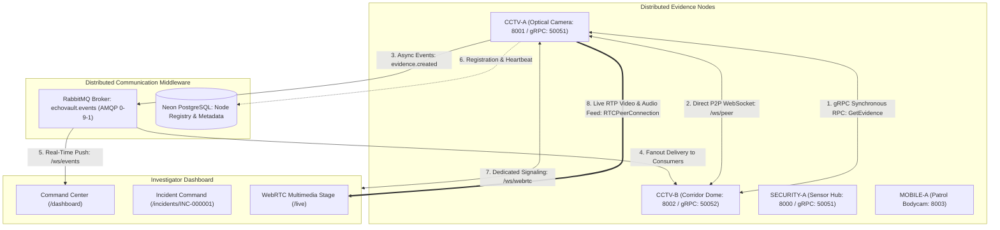

# EchoVault

**EchoVault** is a Distributed Digital Evidence Collection, Incident Reconstruction, and Real-Time Multimedia Streaming System developed for the Distributed Systems FA-1 evaluation.

It demonstrates how autonomous, heterogeneous evidence-producing nodes (`CCTV-A`, `CCTV-B`, `SECURITY-A`, `MOBILE-A`) cooperate across a partitioned network to collect, authenticate, correlate, and stream forensic evidence without relying on centralized storage.

---

## 1. Complete FA-1 Distributed Architecture

EchoVault implements six distinct communication layers, keeping responsibilities strictly separated:

```text
                                ECHOVAULT
                                    │
           ┌────────────────────────┼────────────────────────┐
           │                        │                        │
        Node A                   Node B                   Node C
        CCTV-A                   CCTV-B                 SECURITY-A
           │                        │                        │
     ┌─────┼──────┬──────────┬──────┼──────┬──────────┬──────┼─────┐
     │     │      │          │      │      │          │      │     │
   gRPC  RabbitMQ P2P       gRPC  RabbitMQ P2P       gRPC  RabbitMQ P2P
     │     │      │          │      │      │          │      │     │
     │     ▼      │          │      ▼      │          │      ▼     │
     │ ┌────────┐ │          │  ┌────────┐ │          │  ┌────────┐│
     │ │AMQP Pub│ │          │  │AMQP Pub│ │          │  │AMQP Pub││
     │ └───┬────┘ │          │  └───┬────┘ │          │  └───┬────┘│
     │     │      │          │      │      │          │      │     │
     │     ▼      │          │      ▼      │          │      ▼     │
     │  RabbitMQ  │          │   RabbitMQ  │          │   RabbitMQ │
     │  Broker    │          │   Broker    │          │   Broker   │
     │     │      │          │      │      │          │      │     │
     │     ▼      │          │      │      │          │      │     │
     │ WebSocket  │          │      │      │          │      │     │
     │ /ws/events │          │      │      │          │      │     │
     │     │      │          │      │      │          │      │     │
     └─────┼──────┼──────────┴──────┼──────┼──────────┴──────┼─────┘
           │      │                 │      │                 │
           ▼      ▼                 ▼      ▼                 ▼
   ┌─────────────────────────────────────────────────────────────┐
   │             INVESTIGATOR DASHBOARD & COMMAND CENTER         │
   │                                                             │
   │  • Unified Operations Dashboard       (/dashboard)          │
   │  • Incident Command Center            (/incidents/INC-001)  │
   │  • WebRTC Live Multimedia Stage       (/live)               │
   │  • Direct P2P Mesh Manager            (/peers)              │
   │  • Real-Time Messaging Monitor        (/messaging)          │
   │  • System Health & Diagnostics        (/system)             │
   └─────────────────────────────────────────────────────────────┘
```



---

## 2. Communication Mechanisms Comparison Matrix

| Mechanism | Communication | Transport | Pattern | Syllabus Role & Purpose |
| :--- | :--- | :--- | :--- | :--- |
| **REST** | Browser $\leftrightarrow$ Backend | HTTP/1.1 / JSON | Request / Response | Stateless CRUD, Node registration, Incident management |
| **gRPC** (Part 5) | Node $\leftrightarrow$ Node | HTTP/2 / Protobuf | Synchronous RPC | Inter-node procedure calls (`GetEvidence`, `GetNodeStatus`) with timeouts |
| **RabbitMQ** (Part 6) | Node $\rightarrow$ Broker $\rightarrow$ Nodes | AMQP 0-9-1 | Asynchronous Pub/Sub | Decoupled 1-to-N event persistence with DLX and topic routing |
| **WebSocket Stream** (Part 7) | Backend $\rightarrow$ Browser | WebSocket (`/ws/events`) | Continuous Stream | Real-time event push updates for investigator UI dashboards |
| **P2P WebSocket** (Part 8) | Node $\leftrightarrow$ Node | WebSocket (`/ws/peer`) | Point-to-Point Mesh | Direct node-to-node control, telemetry, and announcements without broker |
| **WebRTC** (Part 9) | Node $\leftrightarrow$ Browser | UDP / SRTP / RTP | Real-Time Multimedia | Low-latency live video (25 FPS HUD) and audio streaming from cameras |

---

## 3. Distributed Node Model

EchoVault ships with 4 pre-configured demo nodes:

| Node ID | Node Name | Type | Video | Audio | HTTP Port | gRPC Port | Role & Description |
| :--- | :--- | :--- | :---: | :---: | :---: | :---: | :--- |
| `CCTV-A` | CCTV Camera A | `EVIDENCE` | YES | YES | `8001` | `50051` | Fixed perimeter optical camera overlooking Sector 4 |
| `CCTV-B` | CCTV Camera B | `EVIDENCE` | YES | YES | `8002` | `50052` | Dome camera monitoring emergency exit corridor |
| `SECURITY-A` | Security Sensor Hub | `SECURITY` | YES | NO | `8000` | `50051` | IoT sensor gateway aggregating IR tripwires |
| `MOBILE-A` | Mobile Patrol Unit A | `MOBILE` | YES | YES | `8003` | `50053` | Wearable body-camera and acoustic scanner |

---

## 4. Local Evidence Ownership & Shared Logical Incident

- **Local Ownership**: Evidence is strictly owned by the capturing node (`EV-001` owned by `CCTV-A`, `EV-002` by `CCTV-B`, etc.). Nodes maintain independent evidence stores.
- **Shared Logical Incident**: Incident `INC-000001` ("Restricted Area Intrusion", Severity: HIGH, Status: OPEN) links multi-node observations into a single investigation context.
- **Remote Access via gRPC**: To view evidence owned by another node, an investigator triggers an inter-node gRPC request (`GetEvidence`), measuring real-time round-trip latency.

---

## 5. One-Command Quickstart

### 1. Launch Complete Stack with Docker
```powershell
docker compose up --build
```

**Services Running:**
- **Coordinator Backend**: `http://localhost:8000`
- **Node A (CCTV-A)**: `http://localhost:8001`
- **Node B (CCTV-B)**: `http://localhost:8002`
- **RabbitMQ Management**: `http://localhost:15672` (guest/guest)
- **Frontend Command Center**: `http://localhost:3000`

### 2. Seed Demo Scenario
```powershell
python scripts/seed_demo.py
```
*Or click **"🌱 Re-Seed Demo Environment"** on `http://localhost:3000/system`.*

---

## 6. End-to-End Demonstration Sequence

1. **Dashboard & Topology**: Open `http://localhost:3000/dashboard` to observe system metrics and the interactive network topology map.
2. **Incident Command Center**: Open `http://localhost:3000/incidents/INC-000001` to view multi-node evidence with `LOCAL` vs `REMOTE` tags.
3. **Synchronous gRPC Retrieval**: Click **"Fetch via gRPC"** on `EV-002` (owned by `CCTV-B`) to fetch remote metadata with measured latency (e.g. 12 ms).
4. **Direct P2P Announcement**: In the P2P tool, select `CCTV-B` and send a direct alert over `/ws/peer` without RabbitMQ in the message path.
5. **Live WebRTC Video**: Click **"📹 Live Feed"** on `CCTV-A` to open `http://localhost:3000/live?nodeId=CCTV-A` and stream live 25 FPS video with real-time updating timestamp ticker and audio tone.
6. **Fault Simulation & Independence**: Navigate to `http://localhost:3000/system`, simulate taking `CCTV-B` OFFLINE, and observe how `CCTV-A`, RabbitMQ, and WebRTC remain operational.

---

## 7. Testing

```powershell
cd services/node

# Run full test suite (104 tests)
python -m pytest tests/ -v
```

**Test Coverage Summary:**
- Unit & Model tests (Node, Evidence, Incident): 42 tests
- gRPC RPC Server & Client tests: 8 tests
- RabbitMQ Publisher & Consumer tests: 12 tests
- WebSocket Stream & Filtering tests: 24 tests
- P2P Protocol & Idempotency tests: 18 tests
- WebRTC Tracks & Signaling tests: 14 tests
- End-to-End Workflow tests: 4 tests
- **Total: 104 passed, 1 skipped (DB integration), 0 failed.**

---

## 8. Documentation Suite

- [`docs/architecture.md`](file:///c:/7th%20Semester/Distributed%20Systems/FA-1-Project/docs/architecture.md) — Technical architecture, node boundaries, and communication topologies.
- [`docs/fa1-syllabus-mapping.md`](file:///c:/7th%20Semester/Distributed%20Systems/FA-1-Project/docs/fa1-syllabus-mapping.md) — Direct mapping to Unit 1 and Unit 2 syllabus topics.
- [`docs/design-decisions.md`](file:///c:/7th%20Semester/Distributed%20Systems/FA-1-Project/docs/design-decisions.md) — Architectural justifications and trade-off analyses.
- [`docs/fa1-demo-script.md`](file:///c:/7th%20Semester/Distributed%20Systems/FA-1-Project/docs/fa1-demo-script.md) — 11-step evaluation walkthrough script with examiner talking points.
- [`docs/fa1-viva.md`](file:///c:/7th%20Semester/Distributed%20Systems/FA-1-Project/docs/fa1-viva.md) — 20+ examination viva questions and comprehensive model answers.

---

## 9. Limitations & FA-2 Roadmap

### FA-1 Limitations
- Synthetic video/audio generators (`DemoVideoTrack`, `DemoAudioTrack`) are used to ensure reproducible testing in Docker.
- Clock synchronization and global event ordering are based on server wall-clock timestamps rather than logical/vector clocks.

### Future FA-2 Roadmap
- **Unit 3**: Lamport timestamps, Vector clocks, Berkeley/NTP clock synchronization, Bully/Ring election algorithms, Ricart-Agrawala distributed mutual exclusion.
- **Unit 4**: Distributed file system integration (IPFS/NFS), distributed transactions (2PC/3PC), and consensus algorithms (Raft).
