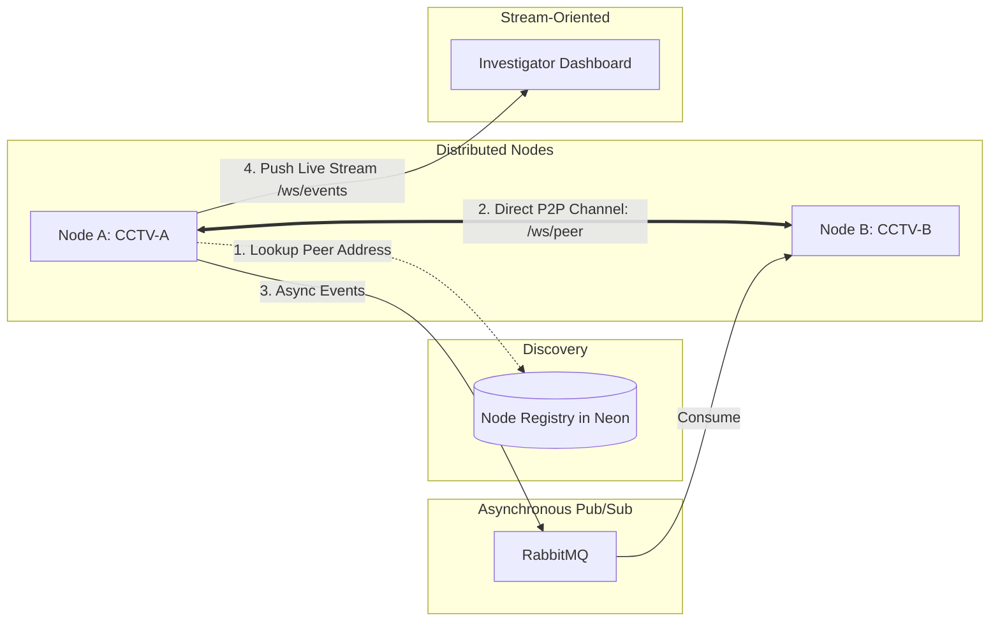

# EchoVault

EchoVault is a Distributed Digital Evidence Collection and Incident Reconstruction System. It is being developed as a Distributed Systems mini-project, with independent evidence-producing nodes and a coordinator boundary designed for incremental communication features.

> **Current implementation:** Part 8 — Peer-to-Peer Messaging. Nodes can discover peer endpoints via the persistent Node Registry and establish direct, point-to-point WebSocket channels (`/ws/peer`) with mutual handshake verification, direct messaging, latency measurement, and targeted announcements without intermediate broker mediation.

## Architecture

```text
                         Node Registry (Discovery)
                              │
                 ┌────────────┼────────────┐
                 │            │            │
                 ▼            ▼            ▼
              Node A       Node B       Node C
                 │            ▲            ▲
                 │            │            │
                 └──────┬─────┘            │
                        │ Direct P2P       │
                        └─── /ws/peer ─────┘
```



## Communication Mechanisms (Unit II Mapping)

EchoVault implements five distinct communication mechanisms, each fulfilling a specific architectural role in distributed systems:

| Mechanism | Endpoints | Pattern | Transport | Characteristics |
|-----------|-----------|---------|-----------|-----------------|
| **REST** | Browser $\rightarrow$ Backend | Request/Response | HTTP/JSON | Stateless, client-initiated CRUD |
| **gRPC** (Part 5) | Node $\rightarrow$ Node | Synchronous RPC | HTTP/2 Protobuf | Low-latency binary RPC with request IDs & deadlines |
| **RabbitMQ** (Part 6) | Node $\rightarrow$ Broker $\rightarrow$ N Nodes | Asynchronous Pub/Sub | AMQP 0-9-1 | Decoupled 1-to-N persistence, DLX, broker-mediated |
| **WebSocket Stream** (Part 7) | Backend $\rightarrow$ Browser | Continuous Stream | WebSocket (`/ws/events`) | Real-time push updates for UI dashboards |
| **Direct P2P** (Part 8) | Node $\leftrightarrow$ Node | Point-to-Point Mesh | WebSocket (`/ws/peer`) | Direct bidirectional communication; no broker in message path |

---

### Peer-to-Peer Messaging (Part 8)

#### 1. Discovery vs. Transport Separation
- **Discovery**: When Node A wishes to communicate with Node B, it queries the **Node Registry** to retrieve Node B's registered `p2p_host` and `p2p_port`.
- **Transport**: Once the address is obtained, Node A establishes a direct WebSocket connection to `ws://{p2p_host}:{p2p_port}/ws/peer`. **The message itself never passes through the Node Registry or RabbitMQ.**

#### 2. Handshake & Target Identity Verification
Before any application data is exchanged, nodes perform a two-step handshake:
1. Initiator sends `HANDSHAKE` with its `node_id`, `node_name`, and `node_type`.
2. Receiver responds with `HANDSHAKE_ACK` (status `ACCEPTED` or `REJECTED`).
3. **Strict Target Verification**: The initiator verifies `handshake_ack.node_id == expected_node_id`. If an unexpected node responds, the connection is rejected immediately (`PeerIdentityMismatchError`).

#### 3. P2P Protocol & Supported Message Types
Every transmission is encapsulated in a validated `P2PMessageEnvelope`:

```json
{
  "message_id": "peer-9a1b2c3d4e5f",
  "message_type": "PEER_MESSAGE",
  "source_node_id": "CCTV-A",
  "target_node_id": "CCTV-B",
  "timestamp": "2026-08-23T12:00:00Z",
  "protocol_version": "1.0",
  "payload": {
    "text": "Direct sensor telemetry"
  }
}
```

Supported message types:
- `HANDSHAKE` / `HANDSHAKE_ACK` — Identity exchange on connection.
- `PING` / `PONG` — Direct liveness probe and round-trip time (RTT) calculation.
- `PEER_MESSAGE` — Direct node-to-node test/telemetry payload.
- `EVIDENCE_ANNOUNCEMENT` — Metadata-only notification of local evidence capture.
- `INCIDENT_ANNOUNCEMENT` — Metadata-only notification of incident context.

#### 4. Idempotency & Message Auditing
All received P2P messages are checked against the `peer_messages` database table with a unique constraint on `message_id`:
- **First Delivery**: Saved as `RECEIVED` $\rightarrow$ handler executed $\rightarrow$ updated to `PROCESSED`.
- **Duplicate Delivery**: Detected via DB constraint $\rightarrow$ marked as `IGNORED` without re-processing.
- **Failures**: Handler errors are captured as `FAILED` with `error_message`.

#### 5. Bounded Exponential Backoff Reconnection
If an active outbound peer connection drops unexpectedly, the `PeerManager` automatically schedules reconnection attempts with bounded exponential backoff ($1\text{s}, 2\text{s}, 4\text{s}, 8\text{s}, \dots, 30\text{s}$ max) to prevent connection storms.

---

## Technology Stack

- **Frontend:** Next.js, React, TypeScript, App Router, CSS Modules (Turbopack pure selectors)
- **Backend:** Python, FastAPI, Pydantic, asyncio, websockets
- **Database:** Neon PostgreSQL, SQLAlchemy async engine, asyncpg, Alembic migrations
- **Messaging:** RabbitMQ (aio-pika), topic exchange `echovault.events`
- **RPC:** gRPC (grpcio), protobuf contract at `proto/echovault/node.proto`
- **Real-time & P2P:** FastAPI WebSockets (`/ws/events` for UI stream, `/ws/peer` for P2P mesh)
- **Infrastructure:** Docker and Docker Compose

---

## Backend Endpoints

### Health
- `GET /` — service status
- `GET /health` — overall system health (Database, RabbitMQ, gRPC, WebSocket, P2P)
- `GET /health/database` — Neon connectivity check (HTTP 503 on error)
- `GET /health/messaging` — RabbitMQ connectivity check (HTTP 503 on error)
- `GET /health/websocket` — active browser WebSocket connection count
- `GET /health/p2p` — active direct P2P connected peers count

### Node Registry
- `GET /api/v1/node/self` — this process's configured identity (HTTP, gRPC, and P2P addresses)
- `POST /api/v1/node/self/register` — idempotently register this process
- `POST /api/v1/nodes` — register a node
- `GET /api/v1/nodes` — discover nodes
- `POST /api/v1/nodes/{node_id}/heartbeat` — update liveness (`ONLINE`)

### Peer-to-Peer (Part 8)
- `WS /ws/peer` — dedicated node-to-node point-to-point WebSocket
- `GET /api/v1/peers` — list discovered nodes and active P2P link states
- `POST /api/v1/peers/{node_id}/connect` — establish direct P2P link with handshake verification
- `POST /api/v1/peers/{node_id}/disconnect` — terminate direct P2P link
- `POST /api/v1/peers/{node_id}/ping` — transmit direct PING and measure RTT in ms
- `POST /api/v1/peers/{node_id}/message` — send direct P2P text message
- `POST /api/v1/peers/{node_id}/announce/evidence/{evidence_id}` — announce local evidence directly
- `POST /api/v1/peers/{node_id}/announce/incident/{incident_id}` — announce local incident directly
- `GET /api/v1/peers/messages` — query received P2P message inbox with status filters

### Evidence & Incidents
- `POST /api/v1/evidence` — create node-owned evidence observation
- `GET /api/v1/evidence` — list local evidence
- `POST /api/v1/incidents` — create incident
- `GET /api/v1/incidents` — list incidents

### Remote (gRPC) & Messaging (RabbitMQ)
- `GET /api/v1/remote/nodes/{node_id}/status` — query remote status via gRPC
- `GET /api/v1/messaging/messages` — query RabbitMQ received message history

---

## Running Locally

### Docker Setup
```powershell
docker compose up --build
```

Nodes are exposed as:
- **Coordinator**: HTTP `8000`, gRPC `50051`, P2P `8000`
- **Node A (CCTV-A)**: HTTP `8001`, gRPC `50051`, P2P `8001`
- **Node B (CCTV-B)**: HTTP `8002`, gRPC `50052`, P2P `8002`
- **Frontend Dashboard**: `http://localhost:3000`

### Register & Heartbeat Nodes
```powershell
# Register nodes
Invoke-RestMethod -Uri "http://localhost:8000/api/v1/node/self/register" -Method POST
Invoke-RestMethod -Uri "http://localhost:8001/api/v1/node/self/register" -Method POST
Invoke-RestMethod -Uri "http://localhost:8002/api/v1/node/self/register" -Method POST

# Heartbeat nodes
Invoke-RestMethod -Uri "http://localhost:8000/api/v1/nodes/node-docker-001/heartbeat" -Method POST
Invoke-RestMethod -Uri "http://localhost:8001/api/v1/nodes/CCTV-A/heartbeat" -Method POST
Invoke-RestMethod -Uri "http://localhost:8002/api/v1/nodes/CCTV-B/heartbeat" -Method POST
```

---

## Testing

```powershell
cd services/node

# P2P tests only
python -m pytest tests/test_p2p_protocol.py tests/test_p2p_manager.py tests/test_p2p_idempotency.py tests/test_p2p_endpoint.py -v

# Full suite (86 tests)
python -m pytest tests/ -v
```

---

## Future Development
1. Part 9 $\rightarrow$ WebRTC for direct media streaming (using P2P WebSocket control channel for signaling).
2. Part 10 $\rightarrow$ Lamport & Vector Clocks for causal ordering.
3. Part 11 $\rightarrow$ Distributed Election & Mutual Exclusion algorithms.
4. Part 12 $\rightarrow$ Incident Reconstruction Timeline & Global Map Dashboard.
