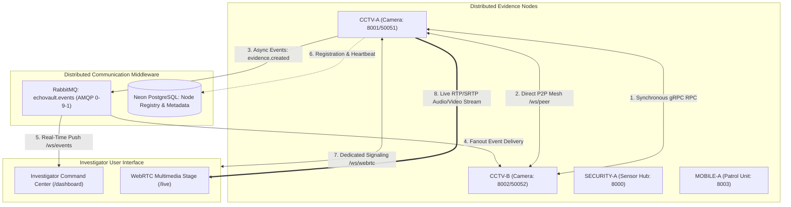

# EchoVault — Distributed Systems Architecture (Part 10 / FA-1)

## 1. System Overview

**EchoVault** is a Distributed Digital Evidence Collection and Incident Reconstruction System designed to model heterogeneous evidence-producing nodes cooperating across an untrusted, partitioned network without relying on centralized shared storage.



---

## 2. Six Communication Mechanisms

| Layer | Transport | Pattern | Syllabus Role & Purpose |
| :--- | :--- | :--- | :--- |
| **REST** | HTTP/1.1 JSON | Request / Response | Client-to-backend CRUD, node registration, incident creation. |
| **gRPC** | HTTP/2 Protobuf | Synchronous RPC | Direct inter-node remote procedure calls (`GetEvidence`, `GetNodeStatus`). |
| **RabbitMQ** | AMQP 0-9-1 | Asynchronous Pub/Sub | Decoupled 1-to-N event publishing with topic routing and durable persistence. |
| **WebSocket** | WebSocket (`/ws/events`) | Continuous Stream | Real-time event broadcasting to investigator dashboards. |
| **P2P WebSocket** | WebSocket (`/ws/peer`) | Point-to-Point Mesh | Direct node-to-node telemetry, health ping/pong, and incident announcements without intermediate broker. |
| **WebRTC** | RTP / SRTP over UDP | Real-Time Multimedia | Low-latency audio and video streaming directly from cameras with dynamic timestamp HUD overlays. |

---

## 3. Data Ownership & Incident Model

- **Local Ownership Principle**: Each evidence record (`EV-001`, `EV-002`, etc.) is strictly owned by the originating node (`CCTV-A`, `CCTV-B`). Nodes store their own raw payloads.
- **Shared Logical Context (`Incident`)**: Incidents (`INC-000001`) act as distributed correlation anchors. Evidence is attached to incidents via relational identifiers without duplicating or merging files into a single database.
- **Remote Access via RPC**: When an investigator inspecting Node A requires evidence owned by Node B, Node A executes a synchronous gRPC call (`GetEvidence`) to Node B. Node A never reads Node B's local storage directly.

---

## 4. WebRTC Architecture & Signaling Separation

```text
Browser UI                                   Evidence Node (CCTV-A)
    │                                                  │
    ├───── 1. WS Connect: /ws/webrtc/{session_id} ────►│ (Signaling WebSocket)
    ├───── 2. Send SDP Offer (Video + Audio) ─────────►│
    │◄──── 3. Receive SDP Answer ──────────────────────┤
    ├───── 4. Trickle ICE Candidates ─────────────────►│
    │◄════ 5. Direct RTP Audio/Video Stream ═══════════╡ (aiortc RTCPeerConnection)
```

- **Signaling Channel (`/ws/webrtc/{session_id}`)**: Carries text-based SDP session descriptions and ICE candidates.
- **Media Transport (`RTCPeerConnection`)**: Delivers live 25 FPS video with surveillance timestamp ticker and 48 kHz audio.
- **Audit Integration**: Lifecycle transitions publish `webrtc.session_requested`, `webrtc.session_started`, `webrtc.session_ended`, and `webrtc.session_failed` to RabbitMQ.

---

## 5. Fault Handling & Isolation

1. **Broker Isolation**: If RabbitMQ goes down, direct P2P messaging, gRPC RPC calls, and WebRTC video streaming continue unaffected.
2. **Node Partitioning**: When a node fails (e.g. `CCTV-B` goes OFFLINE), other nodes (`CCTV-A`, `SECURITY-A`) continue operations. RPC calls to `CCTV-B` return controlled error responses rather than cascading system crashes.
3. **P2P Duplicate Rejection**: Every P2P transmission carries a unique `message_id`. Nodes maintain an in-memory idempotency cache to detect and drop duplicate deliveries.
